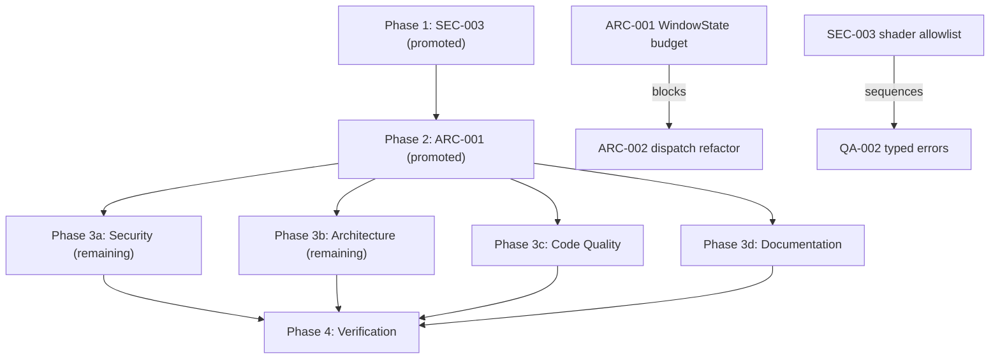

# Project Audit Report

> **Project**: par-term
> **Date**: 2026-10-30
> **Stack**: Rust (Edition 2024), wgpu, tokio, egui — 15-crate workspace
> **Audited by**: Claude Code Audit System
> **Audited commit**: `80357bf0` (main, clean tree; parsight index current)

---

## Executive Summary

par-term is in good health: zero critical findings across all four domains, gates green, and the verification/self-audit infrastructure (cargo-deny in `checkall-ci`, line-count and terminology gates, generated config docs with a freshness test) is well above average for a GUI application. The most significant findings are structural: the WindowState hub grew +37% in impl blocks in three months while already under a tracked remediation item (ARC-001), and the three per-frame event dispatchers hold the workspace's highest complexity under its highest churn (ARC-002). Security posture is strong; the one control that weakens silently as the MCP surface grows is the fail-open `contains("par-term-config")` auto-approval classifier (SEC-001, Medium). Remediation of the seven High issues is roughly 1.5–2 weeks of focused work; roughly half of that is two refactors (ARC-002, ARC-003) that should be sequenced against the open mux-migration backlog.

### Issue Count by Severity

| Severity | Architecture | Security | Code Quality | Documentation | Total |
|----------|:-----------:|:--------:|:------------:|:-------------:|:-----:|
| 🔴 Critical | 0 | 0 | 0 | 0 | **0** |
| 🟠 High     | 4 | 0 | 1 | 2 | **7** |
| 🟡 Medium   | 4 | 3 | 3 | 2 | **12** |
| 🔵 Low      | 3 | 4 | 1 | 4 | **12** |
| **Total**   | **11** | **7** | **5** | **8** | **31** |

### Prior-Cycle Context

This report replaces AUDIT.md from 2026-07-29 (in git history). Recurrence mapping: old ARC-002 (WindowState impl-block growth, 89 → now 122) recurs as **ARC-001**; old QA-010 (typed-error migration, referenced by the live `TODO(QA-010)` in `par-term-render/src/error.rs`) recurs as **QA-002**. No open board cards carried the prior cycle's findings, so all recurring items are filed fresh, tagged `audit-2026-10-30`.

Known open board work NOT re-reported here (referenced, not duplicated): Route every terminal through mux (backlog, L, gated on a stability bar); par-mux report-state verb missing on macdaddy build; par-mux daemon OTLP metrics export; Roster UI: surface last_input_at/stalled/viewer_count from core 0.72; Mux reconnect: replay daemon event ring via events --since; Session picker: workspace restore policy; two Plugin v2 cards deliberately blocked awaiting a named consumer plugin (host-mediated effect commands, typed action arguments); watch card: agent-command user-approval prompt for agent overwrites (D4c trust model).

---

## 🔴 Critical Issues (Resolve Immediately)

None found. No domain surfaced a critical defect.

---

## 🟠 High Priority Issues

### [ARC-001] WindowState hub is still growing under an open remediation item
- **Area**: Architecture (recurrence of prior ARC-002; also found by Code Quality)
- **Location**: `src/app/window_state/mod.rs:148` (struct), 122 `impl WindowState` blocks across `src/`
- **Description**: WindowState is the graph's second-highest-fan-in hub (in-degree 263, articulation point; `get_impact` at depth 2 returns a 96 KB dependent list, risk Critical). It carries 46 `pub(crate)` fields and is spread across 122 impl blocks — up from 89 when measured in July 2026, a +37% increase during which the remediation plan existed. The workspace's two most complex functions (complexity 96 and 84) are methods on this hub. The in-repo memory guidance ("where to put new fields") institutionalizes adding to the hub, so the trend is self-reinforcing.
- **Impact**: Every app-layer feature lands on one type; merge contention and regression blast radius grow with the impl-block count.
- **Remedy**: Enforce a budget, not awareness: extend the gate tooling to fail when the WindowState impl-block count or per-submodule field count exceeds a frozen ceiling, and require new behavior to land as an extracted sub-struct behind the existing facade (the 13-sub-struct extraction in `window_state/` is the established pattern). Blocks ARC-002.

### [ARC-002] Per-frame event-dispatch complexity is extreme and sits at maximum churn
- **Area**: Architecture + Code Quality (merged: arch ARC-102 + QA QA-001)
- **Location**: `src/app/handler/window_state_impl/about_to_wait.rs:25` (complexity 96, churn 91 commits/30d), `src/app/input_events/key_handler/mod.rs:71` (94, churn 89), `src/app/handler/window_state_impl/handle_window_event.rs:14` (84), `src/app/window_manager/config_renderer_apply.rs:24` (78)
- **Description**: The three largest cyclomatic complexities in a 12,788-node graph are the app's three event dispatchers, all methods on the ARC-001 hub. `about_to_wait` already delegates to well-named `check_*` methods, but the sequencing/gating branches alone push complexity past 90 — roughly 10x the conventional threshold. Hotspot scores (churn × complexity): `about_to_wait` 8,736; `handle_key_event` 8,366.
- **Impact**: Every feature lands in these functions first; each edit risks regression in unrelated polling/input duties, and review cost scales with branch count. This is the single most likely origin of the next regressions.
- **Remedy**: Extract the wake-request gating into a declarative poll-task table (task, gate, wake-request) so adding a poller stops growing branches; split `about_to_wait` into ordered phase functions with an explicit queue-priority contract. Must respect the documented wake-request reduction contract (`WindowManager::about_to_wait` reduces per-window requests). Sequence after/with ARC-001 — refactoring first would be invalidated by the sub-struct redistribution.

### [ARC-003] Mux notification subsystem lives app-side as an unbounded, high-churn append zone
- **Area**: Architecture
- **Location**: `src/app/tmux_handler/notifications/` (40 files, ~944 KB); `mux.rs` is 6,896 lines of which ~6,290 are a single trailing `#[cfg(test)]` module (production code ends at line 605)
- **Description**: Daemon-event handling — conceptually adjacent to the `par-term-mux` (1,873 LOC) and `par-term-tmux` (3,368 LOC) crates — is implemented app-side in the directory holding the repo's top churn hotspots (`mux_drain.rs` `check_mux_notifications_with`: churn 7, complexity 39, hotspot 273; `apply_agent_pushes`: churn 22). Every daemon-event feature lands here (roster, graphics replay, pane maps all churned recently). The monolithic test module makes the repo's largest file hostile to navigation and merge; the 800-line gate correctly strips tests, so nothing flags it.
- **Impact**: Change pressure that a crate boundary would force through reviewable interfaces instead accretes as match arms on WindowState.
- **Remedy**: Step 1 (mechanical, conflict-free): split `mux.rs`'s test module into sibling `mux_*_tests.rs` files matching the existing `mux_adopt_tests.rs` convention. Step 2: define the event-handling contract (trait or message enum at the `tmux_handler/` boundary) so daemon events dispatch through a typed seam. Coordinate sequencing with the board card "Route every terminal through mux once mux is proven stable" (`mux_drain.rs`, `notifications/*` are shared files).

### [ARC-004] Duplicated HTTP/download stack with security-relevant logic in two crates
- **Area**: Architecture + Code Quality (merged: arch ARC-104 + QA redact_url/download_file pairs)
- **Location**: `src/http.rs:108` vs `par-term-update/src/http.rs:113` (`redact_url` byte-identical); `download_file` near-duplicate (similarity 0.994); `src/shader_installer.rs:74,174,636-660`
- **Description**: Both files wrap ureq with URL validation and redaction. `src/http.rs` serves shader downloads (host allowlist + redirect-hop checks); `par-term-update/src/http.rs` serves self-update downloads. The root crate already depends on `par-term-update`, so the dependency direction permits consolidation.
- **Impact**: Security-adjacent duplication: the redirect/redaction/allowlist logic guarding untrusted downloads exists twice and will drift independently — a fix to one site silently misses the other.
- **Remedy**: Make `par-term-update/src/http.rs` the single validated-HTTP surface (Layer 2; shader_installer consumes it), or extract a shared `par-term-http` if cross-crate exposure is unwanted. Keep the host allowlist as caller-owned configuration. Consolidate before any future security hardening of URL validation so fixes land once.

### [QA-001] Second-tier complexity cluster: key-code mapping tables implemented as branch chains
- **Area**: Code Quality
- **Location**: `par-term-keybindings/src/platform.rs:169` (`parse_physical_key_code`, 76), `src/app/copy_mode/handler.rs:89` (`handle_copy_mode_key`, 73), `par-term-settings-ui/src/input_tab/keybindings.rs:331` (`key_to_string`, 73), `src/app/window_manager/scripting/mod.rs:86` (`sync_script_running_state`, 68), `src/app/window_state/agent_messages.rs:33` (`process_agent_messages_tick`, 62), `src/app/render_pipeline/post_render.rs:21` (62)
- **Description**: Six functions in the 60–78 complexity band, mostly key-code mappings and mode handlers that are enumerable match arms shaped like tables.
- **Impact**: Same regression profile as ARC-002 at lower churn; runs on every keypress. Exhaustive per-key-code-family unit tests are cheap and currently absent at this granularity.
- **Remedy**: Convert the key-code chains to match tables or lookup arrays (data, not branches); add exhaustive unit tests per key-code family before touching.

### [DOC-001] CHANGELOG has no `[Unreleased]` section and its compare link is pinned five releases back
- **Area**: Documentation
- **Location**: `CHANGELOG.md` (top of file; link reference at line 2076)
- **Description**: Latest entry is `[0.50.0] - 2026-10-24`. Since then main absorbed two user-facing features (`eed71f87` named layouts + workspace exit actions in the session picker; `467ab32b` mux graphics replay + pane upload), a macOS bundle signing fix (`bf74bdd4`), core pin bumps 0.68 → 0.73.0, a full dependency sweep, and parking_lot 0.13 — none recorded. The bottom-of-file link reads `[Unreleased]: .../compare/v0.45.2...HEAD`.
- **Impact**: Release notes drafted from CHANGELOG.md will silently omit the features and the core-version story.
- **Remedy**: Add `## [Unreleased]` with the two features, the signing fix, and the core-pin progression; advance the compare link to `v0.50.0...HEAD`. Execute together with DOC-003 (same shipped-but-unreleased work).

### [DOC-002] `par-term-scripting/SECURITY.md` cites deleted dispatcher and trigger paths
- **Area**: Documentation
- **Location**: `par-term-scripting/SECURITY.md` lines 55-62 and 174-180
- **Description**: This published-crate security-enforcement doc names `src/app/triggers.rs` and "the command dispatcher in `src/app/window_manager.rs`" — both paths no longer exist. The dispatcher now lives at `src/app/window_manager/scripting/mod.rs`; the trigger-event source needs tracing (a probe for `TriggerMatched` under `src/` and `par-term-config/src` found nothing — it may now be defined in emu-core or renamed).
- **Impact**: A security reviewer following the doc audits files dissolved in the module extractions and may conclude the gate was removed.
- **Remedy**: Repoint both references to current locations; trace the current trigger-event source before editing.

---

## 🟡 Medium Priority Issues

### Architecture

### [ARC-005] Point duplications with divergence risk
- **Area**: Architecture + Code Quality (merged: arch ARC-105 + QA pairs)
- **Location / pairs**: `start_refresh_task` (`src/tab/refresh_task.rs:14` vs `src/pane/types/pane_ops.rs:142`, 0.996) — the risky pair: a scheduling/generation-bump fix on one path but not the other produces stale-render bugs; `macos_major_version` (`src/macos_space.rs:161` vs `src/macos_blur.rs:53`, 0.997); `output_with_timeout` (`src/process_timeout.rs:28` vs `par-term-scripting/src/plugin_git.rs:333`); `has_shader_files` (`par-term-config/src/config/path_validation.rs:308` vs `src/shader_installer.rs:300`); `show_shader_error`/`show_cursor_shader_error` (0.978, `par-term-settings-ui/src/shader_editor.rs:355` vs `cursor_shader_editor.rs:239`)
- **Remedy**: One shared helper per pair. Note the crate-layering constraint: hoisting helpers across crates must respect the CLAUDE.md Layer 0-4 bump order (a new util crate or `par-term-config` additions trigger the version-bump checklist).

### [ARC-006] Data-as-code duplication in themes and copy-mode motion
- **Area**: Architecture
- **Location**: `par-term-config/src/themes.rs` (six near-identical theme constructors, similarity 0.858); `src/copy_mode/motion.rs` (five motion functions differing only in char-class predicate and direction sign)
- **Description / Remedy**: Both are declarative data implemented as near-identical functions. The copy-mode motion predicate table is worth extracting; the theme table is optional — the code-quality reviewer judged theme dedup low-value (data declarations read fine as-is). Owner's call; either is acceptable.
- **Note**: parsight's WGSL `vs_main` prologue "duplication" across 6 shaders is inherent to WGSL (no `#include`) — not actionable, excluded.

### [ARC-007] SettingsUI is a second hub of the same shape as WindowState
- **Area**: Architecture
- **Location**: `par-term-settings-ui/src/settings_ui/mod.rs:53` (in-degree 291 — the graph's highest, articulation point)
- **Description**: Unlike ARC-001 it is well contained: Layer 3 crate, clean dependency set, documented `has_changes`/`changes_this_frame` contract, and coverage/registry structure tests other hubs lack.
- **Remedy**: Track growth (same budget idea as ARC-001, advisory); do not restructure now.

### [ARC-008] Full workspace tests do not run on push CI
- **Area**: Architecture
- **Location**: `.github/workflows/ci.yml`
- **Description**: push CI deliberately runs fmt, clippy (default + all-features), the no-default-features check, and cargo-deny only (documented compute tradeoff); tests run on release.yml build legs. Regressions that local `make checkall` misses surface at release time, weeks later.
- **Remedy**: Add a scheduled (nightly) full-test job rather than push-time.

### Security

### [SEC-001] MCP/ACP auto-approval classifies par-term tools "read-only" by name substring, fail-open for future tools
- **Area**: Security (CWE-863 / OWASP A01)
- **Location**: `par-term-acp/src/permissions.rs:304`
- **Description**: `is_read_only` includes `lower.contains("par-term-config") && !is_par_term_screenshot_tool`, so every tool on the par-term MCP server — present and future — is auto-approved unless excluded. Today's exposure is contained (`config_update` restricted to a cosmetic-key allowlist verified at `par-term-mcp/src/tools/config_update.rs:17` — shell/permissions/automation/triggers rejected; `command_create` gated by the D4b first-run ledger), but the classifier matches the agent-supplied tool *name* by substring, not a capability check. Any tool added to `par-term-mcp` tomorrow inherits auto-approval by default.
- **Remedy**: Invert the default — enumerate exact tool names that are safe instead of a namespace `contains()` match. Add a test asserting a deliberately unknown tool name is escalated, not approved. Code Quality work in this file (QA-002 error migration) should run after the default is inverted so the tool-name list is written once.

### [SEC-002] `send_keys_literal` embeds text in single quotes without escaping — latent daemon command-injection
- **Area**: Security (CWE-78-style, daemon wire; OWASP A03) — latent; no current untrusted caller
- **Location**: `par-term-mux/src/client.rs:146`
- **Description**: `format!("send-keys -t %{pane} -l '{text}'")` does no quoting of embedded single quotes and no newline rejection. The mux wire is line-framed: a newline terminates the command mid-way and the remainder parses as a second daemon command (arbitrary send-keys to any pane, new-window, etc.). The same crate does this correctly elsewhere (`env.rs:21` `quote_env_value` escapes `'\''`, `is_wire_safe` rejects newlines; `send_keys_hex` exists for arbitrary bytes). Both current callers pass app-generated content (`mux.rs:3520`), but this is a public API on a published crate — the first future caller forwarding terminal- or agent-derived text turns it into cross-pane injection. Distinct from the open "Mux reconnect: replay daemon event ring" card.
- **Remedy**: Route through `quote_env_value`-style escaping plus the `is_wire_safe` newline/NUL check, or deprecate in favor of `send_keys_hex` for all non-path input. Add a round-trip test like `send_keys` already has. Fix before any mux feature sends agent- or terminal-derived text through the literal path.

### [SEC-003] Agent can install GPU-executed shader code from an agent-writable path with no prompt
- **Area**: Security (CWE-250 / OWASP A05)
- **Location**: `par-term-mcp/src/tools/config_update.rs:19` (`custom_shader` in the cosmetic allowlist) combined with `par-term-acp/src/permissions.rs:169` (temp dirs as safe write roots)
- **Description**: An ACP/MCP agent can (1) write a GLSL file to `$TMPDIR` or `/tmp` (auto-approved write), then (2) set `custom_shader` to that path via the auto-approved config tool. The shader is compiled by naga and executed on the GPU every frame, unprompted. Practical impact is bounded by the GPU driver sandbox, but this is unprompted code execution in the graphics stack, and driver 0-days are a real class.
- **Remedy**: Restrict the `custom_shader` path value to par-term's own shaders config directory (canonicalized), or drop it from the MCP allowlist. A first-use confirmation for non-default paths matches the D4b pattern already used for script commands. Phase 1: this file is also targeted by QA-002 (typed-error migration) — sequence the allowlist decision first.

### Code Quality

### [QA-002] Error-handling model is one crate deep; 75 files use bare `anyhow::Result`
- **Area**: Code Quality (recurrence of prior QA-010 — live `TODO(QA-010)` at `par-term-render/src/error.rs:7`)
- **Location**: workspace-wide; only `par-term-render` has typed thiserror enums
- **Description / Remedy**: Execute the TODO as scoped, in its stated priority order: `par-term-mcp` (IPC protocol errors) first, then `par-term-terminal` (PTY errors). Sequence after the board's mux-everywhere and reconnect-replay cards land to avoid merge contention in `src/app/tmux_handler/notifications/mux.rs`; after SEC-003's allowlist decision in `par-term-mcp`.

### [QA-003] Fifteen zero-caller public methods concentrated in par-term-config
- **Area**: Code Quality (needs consumer verification — parsight registry/dispatch caveat applies; treat each as hypothesis, not verdict)
- **Location**: `par-term-config/src/profile_types/matchers.rs:145,154,169,451` (`find_by_tag`, `filter_by_tags`, `all_tags`, `get_valid_parents`); `par-term-config/src/config/path_validation.rs:140,173,196,246` (four `checked_shader_*`/`should_prompt_shader_install` helpers); `par-term-config/src/shader_metadata/parsing.rs:80,195`; `TriggerRateLimiter::new` (`par-term-config/src/automation.rs:616`); `resolve_tmux_path` (`par-term-config/src/config/persistence.rs:216`); `MetadataCache::with_shaders_dir`; `ResolvedCursorShaderConfig::for_shader`; `JsonRpcClient::new` (`par-term-acp/src/jsonrpc.rs:128`)
- **Impact**: Untested public surface needing maintenance and forward-porting on every breaking change (par-term-config is a published crate).
- **Remedy**: Check crates.io dependents and consumer repos before removal; delete or gate behind a documented pub-API contract anything never consumed.

### [QA-004] Silent-discard patterns concentrated in the config-watcher path
- **Area**: Code Quality
- **Location**: workspace-wide: 261 `let _ =` and 164 `.ok()` sites; densest at `src/app/window_state/config_watchers.rs` (17), `par-term-mux/src/resync.rs` (15), `par-term-acp/src/fs_tools.rs` (12)
- **Description**: Many are deliberate fire-and-forget, but in the config-watcher path a failed config write/notify is indistinguishable from success without debug logging.
- **Remedy**: In `config_watchers.rs` and `resync.rs`, route discards through the existing `debug_warn!`/`log::warn` fault-logging path; leave genuinely benign cases (test seams, channel-close) as-is.

### Documentation

### [DOC-003] Mux graphics replay and pane upload are undocumented repo-wide
- **Area**: Documentation
- **Location**: Missing; natural home `docs/features/MUX.md` (currently documents through named layouts, line 82, and stops)
- **Description**: `467ab32b` + `db204ccc` shipped mux graphics replay (`mux_graphics_osc` map, `process_data` replay) and pane upload via a job worker with daemon caps. No mention in docs/, README, or CHANGELOG. Distinct from the four known mux backlog cards.
- **Remedy**: Add a graphics replay/upload section to MUX.md; fold into the same release-prep pass as DOC-001.

### [DOC-004] Doc-comment density thin in three crates, two published
- **Area**: Documentation
- **Location**: `par-term-ssh/src/` (~6% doc lines), `par-term-mcp/src/` (~7%), `par-term-settings-ui/src/` (~4%); workspace norm 9-16%; `par-term-mux` exemplary
- **Impact**: External consumers of the published SSH/MCP crates rely on the hand-maintained, un-gated `docs/API.md` instead of rustdoc.
- **Remedy**: Bring `par-term-ssh` and `par-term-mcp` public items to the workspace norm; settings-ui can stay lighter (internal-facing; API.md defers it pending the hub remediations).

---

## 🔵 Low Priority / Improvements

### Architecture

### [ARC-009] Makefile target-name quartet
- **Area**: Architecture — `check`, `check-all`, `checkall`, `checkall-ci` overlap. Rename or alias `check-all` into `checkall`; leave three unambiguous entry points.

### [ARC-010] Files crowding the 800-line gate
- **Area**: Architecture + Code Quality (merged: arch ARC-110 + QA QA-008) — 81 production files exceed 500 stripped lines (warn band), 0 fail; nearest the cap: `par-term-terminal/src/terminal/mod.rs` (799), `src/app/render_pipeline/egui_submit.rs` (793), `egui_overlays.rs` (784), `keybinding_actions.rs` (783), `tmux_handler/gateway.rs` (774), `session_logger/core.rs` (773). Managed debt; the ARC-009 extraction-comment practice is working. Keep it as files drift toward 800; no new action beyond monitoring.

### [ARC-011] `detect_config_dir` copied byte-identical between install scripts
- **Area**: Architecture — `gh-pages/install-shaders.sh:16` vs `install_shaders.sh:23`. Published-site copy is acceptable; add a header comment naming the twin to prevent divergent edits.

### Security

### [SEC-004] Unpinned curl-pipe-sh installers
- **Area**: Security — `gh-pages/install-shell-integration.sh` and `install-shaders.sh` run from `raw.githubusercontent.com/.../main` with no tag/commit pinning. Low for a personal project; pin to a release-tagged URL.

### [SEC-005] Plugin installs from git carry no revision pinning
- **Area**: Security — `par-term-scripting/src/plugin_git.rs` clones user-supplied URLs with staging + manifest validation (good), but updates re-clone at the remote default branch, so plugin code can change silently between updates. Record and re-check the cloned commit. Note: `output_with_timeout` in this file is also ARC-005's dedup target — same file, coordinate.

### [SEC-006] par-mux daemon socket permissions are owned by the core repo
- **Area**: Security — upstream finding. `par-term-mux` here is client-only (correctly adds nothing); socket creation/permission hardening lives in `par-term-emu-core-rust` (`MuxClient::connect_or_spawn`). Filed on the par-term-emu-core-rust board with `--filed-by par-term`; a four-agent audit of that repo exists (2026-10-29) — check its socket findings before duplicating work.

### [SEC-007] `is_safe_write_path` auto-approves tmp dirs — symlink-swap TOCTOU
- **Area**: Security — documented in-code as residual risk with the OS-sandbox recommendation; assessed acceptable as-is. Card filed for traceability; expected disposition is "confirmed acceptable", not a code change.

### Code Quality

### [QA-005] std `Mutex` `.lock().unwrap()` poisoning panics
- **Area**: Code Quality — `src/app/triggers/mod.rs:926`, `src/app/tmux_handler/pane_write.rs:104`. A poisoned mutex cascades panics in the PTY-write and trigger paths. Use `unwrap_or_else(|p| p.into_inner())` — the guarded data is append-only command strings where poisoning recovery is safe.

### Documentation

### [DOC-005] Stale font-guide path in scripts README
- **Area**: Documentation — `scripts/README.md:228` points to `docs/QUICK_START_FONTS.md`; the file is at `docs/guides/QUICK_START_FONTS.md` (inline code span, so lychee misses it). One-line fix.

### [DOC-006] Historical `docs/plans/` carries ~180 stale code-path references
- **Area**: Documentation — 43 files, pre-extraction layout; `docs/plans/README.md` declares them historical. Noise, not drift. Add `docs/plans` to the parsight exclusion posture or annotate with the `<!-- doc-path: example -->` waiver convention.

### [DOC-007] Root audit files quote deleted paths verbatim
- **Area**: Documentation — `AUDIT.md` (8 hits), `AUDIT-REMEDIATION-PLAN.md` (13 hits). Intentional evidence-quoting; lychee already excludes both. No action required; waiver markers only if parsight triage noise recurs. (This AUDIT.md refresh rewrites AUDIT.md's hit set.)

### [DOC-008] MIGRATION.md's newest section is v0.48.0 while 0.49.0 carried an upgrade note
- **Area**: Documentation — the 0.49.0 mux-hooks ownership cleanup instructions live only in CHANGELOG; backward compatibility preserved. Add a short v0.49.0 section with the next migration note (pairs with DOC-001's release pass).

---

## Detailed Findings

### Architecture & Design

Agent assessment: overall architecture health **Good** — strong layering, tooling, and documentation; debt is concentrated in the root app layer's hub type and one app-layer subsystem, not in the crate architecture. Verified against parsight at HEAD `80357bf` (939 Rust files, 12,788 graph nodes, ~20.9K call edges, ~255K LOC). Issues ARC-001..ARC-011 above carry the full detail. Supporting observations:

- The Layer 0-4 dependency graph in CLAUDE.md matches the manifests exactly; every sub-crate dep points downward; `par-term-emu-core-rust` declared once in `[workspace.dependencies]`; rust-version 1.99 consistent across all 15 manifests.
- Rendering invariants are enforced and documented: single live pane-rendering path, 3-phase draw ordering centralized in `emit_three_phase_draw_calls`, render-cache generation contract.
- Concurrency policy is disciplined: `Arc<tokio::sync::RwLock<TerminalManager>>` read-preference documented in `docs/architecture/MUTEX_PATTERNS.md` and followed (217 `try_read`/`try_write` sites vs 28 `blocking_*` reserved for user-initiated operations), plus ArcSwap for config reads.

### Security Assessment

Agent assessment: overall security posture **Strong**. No critical or high findings. Issues SEC-001..SEC-007 above carry the full detail. Supporting observations:

- File-permission discipline is exemplary: `par-term-config/src/atomic_save.rs` stages all writes at 0o600, re-restricts stale temp files; session recordings get 0o600 plus password-prompt input redaction (`src/session_logger/core.rs:300`).
- Self-update chain well defended: embedded minisign public key (`par-term-update/src/signature.rs:71`), SHA-256 checksums, macOS staged-bundle verification against the pinned Apple Team ID, HTTPS-only host-allowlisted downloads with per-redirect-hop revalidation.
- ACP permission layer: canonicalize-then-compare with a serialization mutex; SEC-002 NotebookEdit reclassification (prior cycle) verified fixed; write tools always escalate even under `auto_approve`.
- Agent-command trust model intact: provenance enforcement, D4b SHA-256 confirmation ledger re-arming on body change, charset-validated ids. Prior MCP audit's hardening verified current, not assumed.
- No hardcoded credentials; mux env values never logged; MCP server is stdio-only (no network binding).
- Unsafe usage (106 sites) concentrates in expected FFI/render/test areas; dependency set current (lockfile refresh 2026-10-30, core pin 0.73.0, cargo-deny in gate).

### Code Quality

Agent assessment: overall code health **Good**. Issues QA-001..QA-005 above carry the full detail (QA-001 is the High; the remainder merged into ARC-002/004/005/010 where they were the same defect). Supporting observations:

- Technical debt markers are controlled: 5 TODO/FIXME in production code, all referencing tracked card ids; 44 `#[allow]`/`#[expect]` locations, 39 with explicit justification comments.
- Estimated debt: Low-Moderate. 537 production unwrap/expect across ~275K lines is low density (~2/1,000), sampled sites are documented invariants.
- Unsafe usage is narrow and correct under Edition 2024 (~15 real sites: wgpu `as_hal`, CG FFI, test-only `set_var`).
- Test coverage: **Good (>70% estimated)** — 55 integration files under `tests/` plus inline `#[cfg(test)]` modules; 3,534 `#[test]` functions, 22 ignored (PTY-dependent, documented). Assertions are specific (pixel-oracle, run-length, wire-format). Key untested areas: the ARC-002/QA-001 dispatch branch matrices (partially covered behaviorally by `--ui-test`), exhaustive per-key-code-family tests for the mappers.
- parsight dead-code surface is tiny for a workspace this size, confirming active pruning.

### Documentation Review

Agent assessment: overall documentation health **Good** (live user docs near Excellent; gaps concentrate in release-notes accumulation and one stale security doc). Issues DOC-001..DOC-008 above carry the full detail. Review basis: `docs/DOCUMENTATION_STYLE_GUIDE.md` (used as the standard) plus a full inventory of 57 docs files and 12 root markdown files. Supporting observations:

- Documentation drift is mechanically enforced and it shows: generated `CONFIG_REFERENCE.md`/`SETTINGS.md` with a doc-freshness test, `make doc-check` (lychee, anchor-aware), `make check-terminology` (T1-T8). Zero references to dead code paths in the live `docs/` tree, CONTRIBUTING, or README after two major module extractions.
- README examples verified against implementation: every spot-checked config key exists in the correct sub-struct; the `dark-background` theme resolves in `themes.rs`.
- `docs/README.md` indexes every live document; `docs/plans/README.md` honestly declares historical status.

---

## Remediation Roadmap

### Immediate Actions
1. SEC-003 — shader-allowlist trust boundary (Phase 1; conflicts with QA-002's file)
2. SEC-002 — fix `send_keys_literal` quoting before any new mux feature uses it
3. DOC-002 — repoint the published security-enforcement doc at existing files
4. ARC-001 — freeze the WindowState budget (Phase 2; unblocks ARC-002)

### Short-term (Next 1-2 Sprints)
1. DOC-001 + DOC-003 — one release-prep pass (changelog Unreleased + MUX.md graphics replay/upload)
2. SEC-001 — invert the auto-approval classifier default
3. ARC-002 + QA-001 — dispatch refactor and key-code mapper tables (after ARC-001)
4. ARC-003 step 1 — split the 6,290-line test module (mechanical, conflict-free)
5. ARC-004 — consolidate the validated-HTTP surface
6. QA-003 / QA-004 / QA-005 — zero-caller verification, discard logging, mutex poisoning

### Long-term (Backlog)
1. ARC-003 step 2 — typed daemon-event seam (coordinate with the mux-everywhere board card)
2. QA-002 — typed-error migration (par-term-mcp, then par-term-terminal; after mux cards land)
3. ARC-008 — nightly full-test CI job
4. ARC-005 / ARC-006 / ARC-007 — dedup pairs, optional theme table, SettingsUI growth tracking
5. DOC-004 / DOC-008 — rustdoc density, migration-note backlog
6. Remaining Lows (ARC-009/010/011, SEC-004/005/006/007, DOC-005/006/007)

---

## Positive Highlights

1. **Verification infrastructure well above average**: `checkall`/`checkall-ci`/`ci` gates with cargo-deny, a stripped-line-count gate, a UX terminology gate, generated config reference with a doc-freshness test, settings-search self-registration with coverage tests, and a pre-commit secret scan.
2. **Self-auditing culture**: an AUDIT.md re-verification protocol, a crate-bump checklist, and docs/memory that distinguish deliberate design from defect — this audit was faster and more accurate because of it.
3. **Security fundamentals are solid**: 0o600 atomic writes, minisign-signed self-updates with Team-ID-verified staged bundles, host-allowlisted HTTPS with per-redirect-hop revalidation, a first-run confirmation ledger for agent-authored commands.
4. **Disciplined concurrency**: the documented read-preference RwLock policy is actually followed (217 vs 28 sites), with ArcSwap for zero-cost config reads.
5. **Clean crate layering**: the documented Layer 0-4 graph matches every manifest; deps centralized; the external core dependency declared exactly once.
6. **Lint suppressions carry reasons** (GPU lifetime contracts, protocol-required fields) rather than blanket disables; TODO markers reference card ids — debt is tracked, not accumulating silently.
7. **Documentation drift is mechanically enforced**: after two major module extractions, zero dead-path references remain in live docs; README examples verified accurate against the implementation.
8. **`par-term-mux` rustdoc is exemplary**: method docs explain semantics a caller cannot infer (spawn-race loser is not an error; disconnect-without-`%exit` surfaces as `SessionEnded` exactly once).

---

## Audit Confidence

| Area | Files Reviewed | Confidence |
|------|---------------|-----------|
| Architecture | ~939 indexed (graph analytics), ~30 examined closely | High |
| Security | ~30 examined (36 tool calls; call sites traced, allowlists read) | High |
| Code Quality | ~275K LOC via analytics, 32 files examined | High |
| Documentation | 69 files inventoried (57 docs + 12 root), key files read | High |

*parsight graph analytics (dead code, hotspots, complexity, duplication) carry a registry/dispatch caveat: zero-caller findings (QA-003) are hypotheses pending consumer verification, not verdicts.*

---

## Remediation Plan

> This section is generated by the audit and consumed directly by `/fix-audit`.
> It pre-computes phase assignments and file conflicts so the fix orchestrator
> can proceed without re-analyzing the codebase.

### Phase Assignments

#### Phase 1 — Security promoted for file conflict (Sequential, Blocking)
<!-- No Critical Security issues. SEC-003 is promoted: it modifies `par-term-mcp/src/tools/config_update.rs`,
     a conflict file also targeted by QA-002 (Phase 3c). Severity is therefore lower than Critical. -->
| ID | Title | File(s) | Severity |
|----|-------|---------|----------|
| SEC-003 | Agent-installable GPU shader chain (allowlist decision) | `par-term-mcp/src/tools/config_update.rs`, `par-term-acp/src/permissions.rs` | Medium |

#### Phase 2 — Architecture promoted for blocking relationship (Sequential, Blocking)
<!-- No Critical Architecture issues. ARC-001 is promoted: it explicitly gates the ARC-002 dispatch
     refactor (refactoring the dispatchers first would be invalidated by the sub-struct redistribution). -->
| ID | Title | File(s) | Severity | Blocks |
|----|-------|---------|----------|--------|
| ARC-001 | WindowState hub growth budget | `src/app/window_state/mod.rs` + 122 impl blocks | High | ARC-002 |

#### Phase 3 — Parallel Execution

**3a — Security (remaining)**
| ID | Title | File(s) | Severity |
|----|-------|---------|----------|
| SEC-001 | Fail-open tool auto-approval classifier | `par-term-acp/src/permissions.rs` | Medium |
| SEC-002 | `send_keys_literal` quoting | `par-term-mux/src/client.rs` | Medium |
| SEC-004 | Unpinned curl-pipe-sh installers | `gh-pages/install-shell-integration.sh`, `gh-pages/install-shaders.sh` | Low |
| SEC-005 | Plugin git revision pinning | `par-term-scripting/src/plugin_git.rs` | Low |
| SEC-006 | Daemon socket perms (upstream) | par-term-emu-core-rust repo | Low |
| SEC-007 | tmp-dir TOCTOU (documented residual risk) | `par-term-acp/src/permissions.rs` | Low |

**3b — Architecture (remaining)**
| ID | Title | File(s) | Severity |
|----|-------|---------|----------|
| ARC-002 | Event-dispatch complexity refactor | `src/app/handler/window_state_impl/about_to_wait.rs`, `src/app/input_events/key_handler/mod.rs`, `src/app/handler/window_state_impl/handle_window_event.rs`, `src/app/window_manager/config_renderer_apply.rs` | High |
| ARC-003 | Mux notification subsystem (test split, then seam) | `src/app/tmux_handler/notifications/` | High |
| ARC-005 | Point duplications | `src/tab/refresh_task.rs`, `src/pane/types/pane_ops.rs`, `src/macos_space.rs`, `src/macos_blur.rs`, `src/process_timeout.rs`, `par-term-scripting/src/plugin_git.rs`, `par-term-config/src/config/path_validation.rs`, `src/shader_installer.rs`, `par-term-settings-ui/src/shader_editor.rs`, `par-term-settings-ui/src/cursor_shader_editor.rs` | Medium |
| ARC-006 | Themes + copy-mode motion data-as-code | `par-term-config/src/themes.rs`, `src/copy_mode/motion.rs` | Medium |
| ARC-007 | SettingsUI hub growth tracking | `par-term-settings-ui/src/settings_ui/mod.rs` | Medium |
| ARC-008 | Nightly full-test CI job | `.github/workflows/ci.yml` | Medium |
| ARC-009 | Makefile target quartet | `Makefile` | Low |
| ARC-010 | 800-line gate crowding (monitoring) | `par-term-terminal/src/terminal/mod.rs` et al. | Low |
| ARC-011 | install-script twin header | `install_shaders.sh`, `gh-pages/install-shaders.sh` | Low |

**3c — Code Quality (all)**
| ID | Title | File(s) | Severity |
|----|-------|---------|----------|
| QA-001 | Key-code mapper complexity | `par-term-keybindings/src/platform.rs`, `src/app/copy_mode/handler.rs`, `par-term-settings-ui/src/input_tab/keybindings.rs`, `src/app/window_manager/scripting/mod.rs`, `src/app/window_state/agent_messages.rs`, `src/app/render_pipeline/post_render.rs` | High |
| QA-002 | Typed-error migration (TODO QA-010) | `par-term-mcp/src/`, `par-term-terminal/src/` | Medium |
| QA-003 | Zero-caller pub methods | `par-term-config/src/`, `par-term-acp/src/jsonrpc.rs` | Medium |
| QA-004 | Silent-discard logging | `src/app/window_state/config_watchers.rs`, `par-term-mux/src/resync.rs`, `par-term-acp/src/fs_tools.rs` | Medium |
| QA-005 | Mutex poisoning panics | `src/app/triggers/mod.rs`, `src/app/tmux_handler/pane_write.rs` | Low |

**3d — Documentation (all)**
| ID | Title | File(s) | Severity |
|----|-------|---------|----------|
| DOC-001 | CHANGELOG Unreleased + compare link | `CHANGELOG.md` | High |
| DOC-002 | SECURITY.md stale paths | `par-term-scripting/SECURITY.md` | High |
| DOC-003 | MUX.md graphics replay/upload | `docs/features/MUX.md` | Medium |
| DOC-004 | Rustdoc density (ssh, mcp) | `par-term-ssh/src/`, `par-term-mcp/src/` | Medium |
| DOC-005 | Stale font-guide path | `scripts/README.md` | Low |
| DOC-006 | docs/plans stale references (parsight posture) | `docs/plans/` | Low |
| DOC-007 | Audit-file path quoting (informational) | `AUDIT.md`, `AUDIT-REMEDIATION-PLAN.md` | Low |
| DOC-008 | MIGRATION.md v0.49 section | `docs/guides/MIGRATION.md` | Low |

### File Conflict Map

| File | Domains | Issues | Risk |
|------|---------|--------|------|
| `src/http.rs` | Architecture + Code Quality | ARC-004 (merged) | Merged into one issue — fix once |
| `par-term-update/src/http.rs` | Architecture + Code Quality | ARC-004 (merged) | Merged into one issue — fix once |
| `src/shader_installer.rs` | Architecture + Code Quality | ARC-004, ARC-005 (`has_shader_files` pair) | ⚠️ Read before edit |
| `par-term-scripting/src/plugin_git.rs` | Code Quality + Security | ARC-005 (`output_with_timeout`), SEC-005 | ⚠️ Read before edit |
| `par-term-mcp/src/tools/config_update.rs` | Security + Code Quality | SEC-003, QA-002 | ⚠️ Sequence SEC-003 first (Phase 1) |
| `par-term-acp/src/permissions.rs` | Security (SEC-001, SEC-007) | — | Same domain, sequenced 3a |
| `src/app/tmux_handler/notifications/mux.rs` | Architecture + Code Quality | ARC-003, QA-002 | ⚠️ Read before edit |
| `CHANGELOG.md` | Documentation | DOC-001, DOC-003 (same pass) | Same domain |

Also coordinate with open board cards (outside this audit's issue set): `mux_drain.rs` and `src/app/tmux_handler/notifications/*` are shared with the "Route every terminal through mux" card; QA-002's mux-notification files are shared with the mux-everywhere and reconnect-replay cards.

### Blocking Relationships

- ARC-001 → ARC-002: extract WindowState sub-structs first; the dispatchers are the primary consumers of the fields being redistributed — refactoring first would be immediately invalidated
- SEC-003 → QA-002: the allowlist decision reshapes `par-term-mcp/src/tools/config_update.rs` before typed-error migration rewrites the module
- ARC-004 → (future security hardening): consolidate to one HTTP surface first so URL-validation fixes land once and reviewers audit a single site
- SEC-002 → (future mux features): fix the quoting hazard before anything sends agent- or terminal-derived text through the literal path
- QA-002 → (board: mux-everywhere, reconnect replay): sequence the typed-error migration after those land to avoid merge contention in `src/app/tmux_handler/notifications/mux.rs`
- ARC-003 → (board: route-every-terminal-through-mux): coordinate sequencing; the test-module split (step 1) is mechanical and may proceed first
- DOC-001 ↔ DOC-003: same release-prep pass; writing them separately invites a second drift window
- DOC-002: trace the current trigger-event source before editing — `TriggerMatched` did not resolve under `src/` or `par-term-config/src`; the event may now live in emu-core or be renamed

### Dependency Diagram

