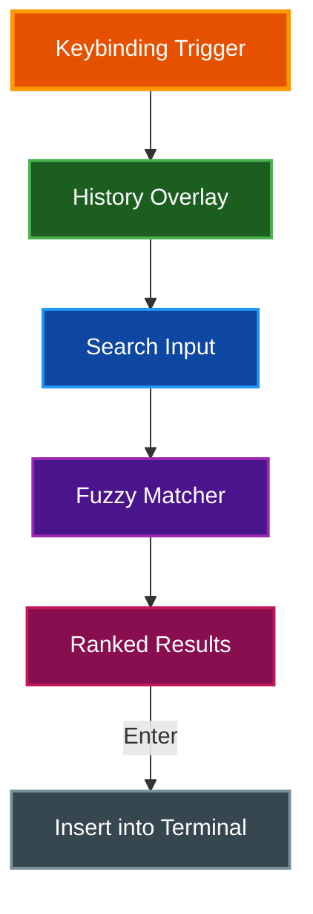

# Command History

par-term includes a fuzzy command history search overlay for quickly finding and re-executing previous commands.

## Table of Contents
- [Overview](#overview)
- [Opening Command History](#opening-command-history)
- [Fuzzy Matching](#fuzzy-matching)
- [Navigation](#navigation)
- [Entry Details](#entry-details)
- [History Capture](#history-capture)
- [Configuration](#configuration)
- [Related Documentation](#related-documentation)

## Overview

The command history search provides a searchable overlay for browsing and selecting from your command history with fuzzy matching, exit code indicators, and relative timestamps.



## Opening Command History

| Action | macOS | Linux/Windows |
|--------|-------|---------------|
| Open command history | `Cmd + Shift + ;` | `Ctrl + Alt + R` |

> **Note:** `Ctrl+R` (and on macOS `Cmd+R`) is left to the shell's own reverse search. The macOS default is iTerm2's `Cmd + Shift + ;`, written `CmdOrCtrl+Shift+:` in `config.yaml`; you can reassign either in keybindings.

The overlay appears over the terminal with a search input field and a scrollable list of previous commands.

## Fuzzy Matching

The search uses the Skim fuzzy matching algorithm for ranked results:

- Type any substring or abbreviation to filter commands
- Results are ranked by match quality (best matches appear first)
- Matching characters are highlighted in yellow with a yellow underline
- Matching is smart-case: all-lowercase queries match case-insensitively, while queries containing uppercase require exact-case matches

**Examples:**

| Query | Matches |
|-------|---------|
| `gco` | `git checkout`, `git commit`, `git config` |
| `dkr` | `docker run`, `docker restart` |
| `mk` | `make build`, `make test`, `mkdir` |

## Navigation

| Key | Action |
|-----|--------|
| `Arrow Up` / `Arrow Down` | Move selection up or down |
| `PageUp` / `PageDown` | Move selection a page at a time |
| `Home` / `End` | Jump to the first or last result |
| `Enter` | Insert selected command into terminal |
| Click | Insert clicked command into terminal |
| `Escape` or the toggle chord | Close overlay without inserting |

The list shows 14 rows at a time and scrolls to keep the selection visible. A count above the list reads `N / M commands` (matches / total), and a footer line names the live keys, including the current toggle chord. The overlay uses the shared picker component, so these keys match the other pickers.

Inserting pastes the command text at the prompt. It does not press Enter, so you can edit the command before running it.

## Entry Details

Each history entry displays:

- **Command text** with fuzzy match highlighting
- **Exit code indicator**: green check-circle icon for success (exit 0), red times-circle icon for failure (non-zero), gray question mark for unknown
- **Relative timestamp**: how long ago the command was executed (e.g., "30s ago", "2m ago", "1h ago", "3d ago")

Commands longer than 120 characters are truncated with `...` in the list. The tooltip shows the full text.

Hover over an entry to see a tooltip with the full command, exit code, duration (when available), and relative time.

## History Capture

Commands are captured from two sources:

1. **OSC 133 shell integration markers**: When shell integration is installed, par-term captures commands (with exit code and duration) from scrollback marks as they execute via the standard shell integration protocol
2. **Core library history**: The terminal emulation core tracks command input independently

Capture runs only when the scrollback has grown since the last sync.

**Deduplication**: History is keyed by trimmed command text, and empty commands are ignored. Re-executing a command moves it to the top of the list with updated metadata rather than creating a duplicate entry. Within a session, a command is added once. Later runs of the same command only refresh its stored exit code and duration.

## Configuration

```yaml
# Maximum number of history entries to keep (default: 1000, range: 100-10000)
command_history_max_entries: 1000
```

**Settings UI:** Settings > General > Search & Links

**Persistence:** History is saved across restarts to `~/.config/par-term/command_history.yaml`. The file is written atomically with owner-only permissions (`0o600`) because command lines can contain secrets. It is saved in a background thread on shutdown.

## Related Documentation

- [Keyboard Shortcuts](../guides/KEYBOARD_SHORTCUTS.md) - All keyboard shortcuts
- [Search](SEARCH.md) - Terminal text search (separate feature)
- [Integrations](INTEGRATIONS.md) - Shell integration for command capture
